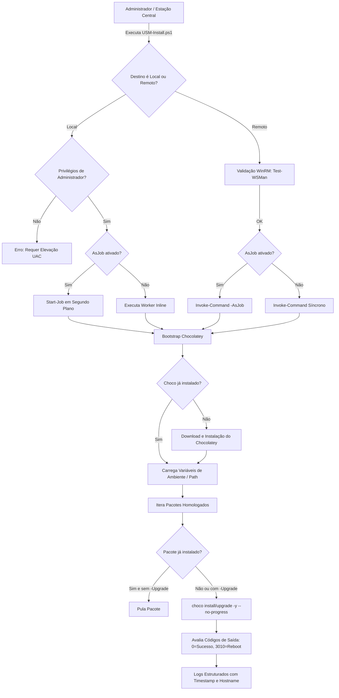

# USM-Install | Unattended Software Manager

Solução corporativa para automação de instalação padronizada de softwares em ambientes Windows, utilizando **PowerShell** e o gerenciador de pacotes **Chocolatey**.

Projetado para eliminar processos manuais de instalação (download de executáveis, avançar wizards e clicar em botões), permitindo provisionamento rápido, silencioso e gerenciável remotamente em escala através de **WinRM**, **PSSessions** e **PowerShell Jobs**.

---

## 📋 Sumário
1. [Visão Geral da Arquitetura](#-visão-geral-da-arquitetura)
2. [Recursos Principais](#-recursos-principais)
3. [Pré-requisitos](#-pré-requisitos)
4. [Instalação e Estrutura dos Arquivos](#-instalação-e-estrutura-dos-arquivos)
5. [Como Utilizar (Exemplos Práticos)](#-como-utilizar-exemplos-práticos)
   - [Cenário 1: Execução Local](#cenário-1-execução-local)
   - [Cenário 2: Execução Remota em Múltiplas Máquinas via Jobs](#cenário-2-execução-remota-em-múltiplas-máquinas-via-jobs)
   - [Cenário 3: Gerenciamento e Monitoramento dos Jobs](#cenário-3-gerenciamento-e-monitoramento-dos-jobs)
6. [Personalização da Lista de Softwares](#-personalização-da-lista-de-softwares)
7. [Tratamento de Erros e Boas Práticas](#-tratamento-de-erros-e-boas-práticas)

---

## 🏗 Visão Geral da Arquitetura



---

## 🚀 Recursos Principais

- **Acentuação e Caracteres Corretos (UTF-8 com BOM)**: Configurado especificamente para o Windows PowerShell 5.1 e terminal moderno, eliminando caracteres corrompidos (`SELEÇÃO`, `Utilitários`, `Opção`).
- **Detecção Visual de Softwares Instalados**: O menu identifica em tempo real o que já está na máquina e exibe a tag `[Já Instalado vX.Y]` em verde ou `[Disponível]`.
- **Baixar Novamente (Opcional)**: Se o programa já estiver instalado, você escolhe se deseja **baixar e reinstalar novamente** ou **pular** para não baixar à toa.
- **Loop Interativo Sem Fechar**: Permite selecionar e instalar outros softwares sucessivamente sem precisar reabrir o script.
- **Menu Interativo Flexível**: Suporta digitação de números (ex: `1, 4, 7`) ou janela gráfica com caixas de seleção (`Out-GridView`) ao digitar `G`.
- **Auto-Elevação de Privilégios (UAC)**: Solicita automaticamente elevação de Administrador caso aberto sem privilégios.
- **Launcher de Duplo Clique (`Executar-USM.bat`)**: Facilita o uso para técnicos executarem direto pelo Windows Explorer.
- **Execução Remota e Jobs**: Suporta envio em segundo plano (`-AsJob`) para múltiplos computadores via WinRM.

---

## ⚙ Pré-requisitos

### 1. Na máquina do operador (onde o script é iniciado)
- PowerShell 5.1 ou PowerShell 7+.
- Política de execução permissiva para scripts:
  ```powershell
  Set-ExecutionPolicy RemoteSigned -Scope LocalMachine -Force
  ```

### 2. Nas máquinas remotas (alvos)
- Serviço WinRM habilitado e porta do firewall liberada (padrão HTTP: `5985`, HTTPS: `5986`):
  ```powershell
  # Em cada máquina remota (ou via GPO no Active Directory):
  Enable-PSRemoting -Force
  ```
- No caso de ambiente sem domínio (Workgroup), configurar o TrustedHosts na máquina de origem:
  ```powershell
  Set-Item WSMan:\localhost\Client\TrustedHosts -Value "*" -Force
  ```
- Acesso à Internet para download do Chocolatey e dos instaladores de pacotes (ou servidor de cache interno/NuGet corporativo).

---

## 📁 Instalação e Estrutura dos Arquivos

Copie o arquivo `USM-Install.ps1` para a pasta de utilitários da sua equipe:

```
Projeto Alura/
│
├── USM-Install.ps1     # Script principal de automação em PowerShell
├── Executar-USM.bat    # Launcher de 2 cliques com auto-elevação UAC
└── README.md           # Documentação completa
```

---

## 💻 Como Utilizar (Exemplos Práticos)

### Cenário 1: Execução Local

#### a) Executar com os softwares corporativos padrão (Síncrono)
Abra o PowerShell como **Administrador** e rode:
```powershell
.\USM-Install.ps1
```

#### b) Instalar pacotes específicos
```powershell
.\USM-Install.ps1 -Packages "googlechrome", "vscode", "7zip.install"
```

#### c) Atualizar pacotes existentes
```powershell
.\USM-Install.ps1 -Packages "git.install", "vlc" -Upgrade
```

#### d) Executar localmente em segundo plano (Job local)
```powershell
.\USM-Install.ps1 -AsJob
```

---

### Cenário 2: Execução Remota em Múltiplas Máquinas via Jobs

#### a) Disparar para um computador remoto em segundo plano
```powershell
# Solicita credenciais corporativas com privilégio de Admin no alvo
$cred = Get-Credential

# Dispara a instalação assíncrona
.\USM-Install.ps1 -ComputerName "WS-ESTACAO-10" -Credential $cred -AsJob
```

#### b) Disparar em lote para várias estações
```powershell
$estacoes = @("WS-FIN-01", "WS-FIN-02", "WS-RH-01", "WS-TI-05")
$cred = Get-Credential

.\USM-Install.ps1 -ComputerName $estacoes -Credential $cred -AsJob -JobName "Deploy-Padrao"
```

#### c) Envio através do Pipeline
```powershell
"WS-DEV-01", "WS-DEV-02" | .\USM-Install.ps1 -Credential $cred -AsJob
```

---

### Cenário 3: Gerenciamento e Monitoramento dos Jobs

Ao utilizar o parâmetro `-AsJob`, o script libera o seu terminal instantaneamente. Utilize os cmdlets nativos de Jobs do PowerShell para acompanhar o progresso:

#### 1. Listar os Jobs ativos e status de execução
```powershell
Get-Job -Name "USM-Install-Job*"
```
*Saída esperada:*
```text
Id     Name                     PSJobTypeName   State         HasMoreData     Location
--     ----                     -------------   -----         -----------     --------
1      USM-Install-Job-Remot... RemoteJob       Running       True            WS-FIN-01,WS-FIN-02
```

#### 2. Aguardar a conclusão de todos os computadores
```powershell
Get-Job -Name "USM-Install-Job*" | Wait-Job
```

#### 3. Ler o log de saída retornado pelas máquinas
```powershell
# O parâmetro -Keep preserva os dados no buffer para consultas posteriores
Get-Job -Name "USM-Install-Job*" | Receive-Job -Keep
```

#### 4. Limpar Jobs concluídos da memória
```powershell
Get-Job -Name "USM-Install-Job*" | Where-Object { $_.State -eq 'Completed' } | Remove-Job
```

---

## 📦 Catálogo de Softwares Homologados

O catálogo no [USM-Install.ps1](file:///c:/Users/07899861403/Documents/Projeto%20Alura/USM-Install.ps1) agora inclui ferramentas essenciais para administradores de sistemas, infraestrutura, redes e desenvolvedores:

| ID no Chocolatey | Nome do Software | Categoria | Por que é Essencial para Infraestrutura? |
| :--- | :--- | :--- | :--- |
| `temurin21` | **Eclipse Temurin JDK 21 (Java)** | Runtimes & SDKs | Versão LTS oficial do OpenJDK (adotada amplamente pelo mercado), sem custos de licenciamento Oracle. |
| `vcredist-all` | **Visual C++ All-in-One** | Runtimes & SDKs | Instala todas as bibliotecas de runtime C++ (2005 a 2022 x86/x64). Evita erros de DLL faltando no Windows. |
| `visualstudio2022community` | **Visual Studio 2022 Community** | Desenvolvimento | IDE completo com suporte a compiladores C/C++, depuração nativa e ferramentas de build. |
| `sysinternals` | **Sysinternals Suite** | Infra & Diagnóstico | Kit definitivo da Microsoft (ProcMon, Process Explorer, TCPView, PsExec, Autoruns) para troubleshooting avançado. |
| `wireshark` | **Wireshark** | Redes & Diagnóstico | Analisador e sniffer de pacotes de rede para investigar latência, DNS, tráfego TCP/UDP e firewalls. |
| `advanced-ip-scanner` | **Advanced IP Scanner** | Redes & Diagnóstico | Mapeador veloz de sub-redes, descobre IPs ativos, endereços MAC e portas abertas em segundos. |
| `putty.install` | **PuTTY** | Acesso Remoto | Cliente leve e confiável para acesso SSH a roteadores, switches, servidores Linux e conexões Seriais. |
| `winscp.install` | **WinSCP** | Acesso Remoto | Cliente gráfico de transferência segura de arquivos via SFTP, SCP e FTP com suporte a sincronização. |
| `microsoft-windows-terminal` | **Windows Terminal** | Terminais & Shells | Terminal moderno com abas, atalhos, suporte a múltiplos perfis (PowerShell, CMD, WSL). |
| `powershell-core` | **PowerShell 7 (pwsh)** | Terminais & Shells | Versão moderna e de alto desempenho do PowerShell, ideal para scripts avançados de automação e cloud. |
| `python3` | **Python 3** | Runtimes & SDKs | Padrão da indústria para scripts de automação, Ansible, SDKs de nuvem (AWS/Azure) e IaC. |
| `docker-desktop` | **Docker Desktop** | Containers & Infra | Criação, teste e gerenciamento de containers Linux/Windows em ambiente local. |
| `dbeaver` | **DBeaver Community** | Banco de Dados | Gerenciador universal de banco de dados (PostgreSQL, MySQL, SQL Server, Oracle, SQLite). |
| `git.install` | **Git** | Desenvolvimento | Controle de versão para repositórios de scripts, infraestrutura como código (IaC) e GitOps. |
| `vscode` | **Visual Studio Code** | Desenvolvimento | Editor de código mais popular, suporte completo a PowerShell, Python, Terraform e Docker. |
| `7zip.install` | **7-Zip** | Utilitários | Compactador/descompactador universal (.zip, .7z, .tar.gz, .iso). |
| `notepadplusplus.install` | **Notepad++** | Editores | Editor rápido para análise de arquivos de log gigantes, scripts e configs. |
| `powertoys` | **Microsoft PowerToys** | Utilitários | Utilitários de produtividade da Microsoft (redimensionador, zonas de janela, OCR, busca rápida). |
| `adobereader` | **Adobe Acrobat Reader DC** | Produtividade | Visualizador padrão de documentos PDF corporativos. |
| `googlechrome` | **Google Chrome** | Navegadores | Navegador web homologado corporativo. |
| `firefox` | **Mozilla Firefox** | Navegadores | Navegador alternativo de alta compatibilidade. |
| `brave` | **Brave Browser** | Navegadores | Navegador focado em privacidade e bloqueio nativo de rastreadores. |
| `vlc` | **VLC Media Player** | Multimídia | Player universal com suporte a praticamente todos os codecs de áudio/vídeo. |
| `spotify` | **Spotify** | Multimídia | Streaming de áudio. |
| `discord` | **Discord** | Comunicação | Comunicação por voz e texto para equipes. |

---

## 🛡 Tratamento de Erros e Boas Práticas

| Código / Cenário | Significado | Ação Tomada pelo Script |
| :--- | :--- | :--- |
| **Exit Code 0** | Instalação concluída com sucesso | Registra log verde `[SUCCESS]` |
| **Exit Code 3010** | Sucesso, mas o Windows requer reinicialização | Registra log amarelo `[WARNING]` informando a necessidade de reboot |
| **Exit Code 1603 / Outros** | Falha de instalador MSI ou Chocolatey | Registra log vermelho `[ERROR]` com detalhes da exceção sem interromper a fila de pacotes seguintes |
| **Test-WSMan Falha** | Máquina inacessível via WinRM | Notifica falha de conectividade antes do disparo do comando |
| **Sem privilégios de Admin** | Usuário comum tentou executar o script | Interrompe a execução imediatamente para evitar instalações parciais |
