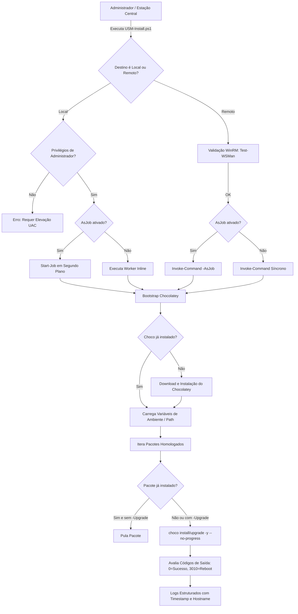

# USM-Install | Unattended Software Manager

Solução corporativa para automação de instalação padronizada de softwares em ambientes Windows, utilizando **PowerShell** e o gerenciador de pacotes **Chocolatey**.

Projetado para eliminar processos manuais de instalação (download de executáveis, avançar wizards e clicar em botões), permitindo provisionamento rápido, silencioso e gerenciável remotamente em escala através de **WinRM**, **PSSessions** e **PowerShell Jobs**.

---

## 📋 Sumário
1. [Visão Geral da Arquitetura](#-visão-geral-da-arquitetura)
2. [Recursos Principais](#-recursos-principais)
3. [Pré-requisitos](#-pré-requisitos)
4. [Instalação e Estrutura dos Arquivos](#-instalação-e-estrutura-dos-arquivos)
5. [Como Utilizar (Exemplos Práticos)](#-como-utilizar-exemplos-práticos)
   - [Cenário 1: Execução Local](#cenário-1-execução-local)
   - [Cenário 2: Execução Remota em Múltiplas Máquinas via Jobs](#cenário-2-execução-remota-em-múltiplas-máquinas-via-jobs)
   - [Cenário 3: Gerenciamento e Monitoramento dos Jobs](#cenário-3-gerenciamento-e-monitoramento-dos-jobs)
6. [Personalização da Lista de Softwares](#-personalização-da-lista-de-softwares)
7. [Tratamento de Erros e Boas Práticas](#-tratamento-de-erros-e-boas-práticas)

---

## 🏗 Visão Geral da Arquitetura



---

## 🚀 Recursos Principais

- **Acentuação e Caracteres Corretos (UTF-8 com BOM)**: Configurado especificamente para o Windows PowerShell 5.1 e terminal moderno, eliminando caracteres corrompidos (`SELEÇÃO`, `Utilitários`, `Opção`).
- **Detecção Visual de Softwares Instalados**: O menu identifica em tempo real o que já está na máquina e exibe a tag `[Já Instalado vX.Y]` em verde ou `[Disponível]`.
- **Baixar Novamente (Opcional)**: Se o programa já estiver instalado, você escolhe se deseja **baixar e reinstalar novamente** ou **pular** para não baixar à toa.
- **Loop Interativo Sem Fechar**: Permite selecionar e instalar outros softwares sucessivamente sem precisar reabrir o script.
- **Menu Interativo Flexível**: Suporta digitação de números (ex: `1, 4, 7`) ou janela gráfica com caixas de seleção (`Out-GridView`) ao digitar `G`.
- **Auto-Elevação de Privilégios (UAC)**: Solicita automaticamente elevação de Administrador caso aberto sem privilégios.
- **Launcher de Duplo Clique (`Executar-USM.bat`)**: Facilita o uso para técnicos executarem direto pelo Windows Explorer.
- **Execução Remota e Jobs**: Suporta envio em segundo plano (`-AsJob`) para múltiplos computadores via WinRM.

---

## ⚙ Pré-requisitos

### 1. Na máquina do operador (onde o script é iniciado)
- PowerShell 5.1 ou PowerShell 7+.
- Política de execução permissiva para scripts:
  ```powershell
  Set-ExecutionPolicy RemoteSigned -Scope LocalMachine -Force
  ```

### 2. Nas máquinas remotas (alvos)
- Serviço WinRM habilitado e porta do firewall liberada (padrão HTTP: `5985`, HTTPS: `5986`):
  ```powershell
  # Em cada máquina remota (ou via GPO no Active Directory):
  Enable-PSRemoting -Force
  ```
- No caso de ambiente sem domínio (Workgroup), configurar o TrustedHosts na máquina de origem:
  ```powershell
  Set-Item WSMan:\localhost\Client\TrustedHosts -Value "*" -Force
  ```
- Acesso à Internet para download do Chocolatey e dos instaladores de pacotes (ou servidor de cache interno/NuGet corporativo).

---

## 📁 Instalação e Estrutura dos Arquivos

Copie o arquivo `USM-Install.ps1` para a pasta de utilitários da sua equipe:

```
Projeto Alura/
│
├── USM-Install.ps1     # Script principal de automação em PowerShell
├── Executar-USM.bat    # Launcher de 2 cliques com auto-elevação UAC
└── README.md           # Documentação completa
```

---

## 💻 Como Utilizar (Exemplos Práticos)

### Cenário 1: Execução Local

#### a) Executar com os softwares corporativos padrão (Síncrono)
Abra o PowerShell como **Administrador** e rode:
```powershell
.\USM-Install.ps1
```

#### b) Instalar pacotes específicos
```powershell
.\USM-Install.ps1 -Packages "googlechrome", "vscode", "7zip.install"
```

#### c) Atualizar pacotes existentes
```powershell
.\USM-Install.ps1 -Packages "git.install", "vlc" -Upgrade
```

#### d) Executar localmente em segundo plano (Job local)
```powershell
.\USM-Install.ps1 -AsJob
```

---

### Cenário 2: Execução Remota em Múltiplas Máquinas via Jobs

#### a) Disparar para um computador remoto em segundo plano
```powershell
# Solicita credenciais corporativas com privilégio de Admin no alvo
$cred = Get-Credential

# Dispara a instalação assíncrona
.\USM-Install.ps1 -ComputerName "WS-ESTACAO-10" -Credential $cred -AsJob
```

#### b) Disparar em lote para várias estações
```powershell
$estacoes = @("WS-FIN-01", "WS-FIN-02", "WS-RH-01", "WS-TI-05")
$cred = Get-Credential

.\USM-Install.ps1 -ComputerName $estacoes -Credential $cred -AsJob -JobName "Deploy-Padrao"
```

#### c) Envio através do Pipeline
```powershell
"WS-DEV-01", "WS-DEV-02" | .\USM-Install.ps1 -Credential $cred -AsJob
```

---

### Cenário 3: Gerenciamento e Monitoramento dos Jobs

Ao utilizar o parâmetro `-AsJob`, o script libera o seu terminal instantaneamente. Utilize os cmdlets nativos de Jobs do PowerShell para acompanhar o progresso:

#### 1. Listar os Jobs ativos e status de execução
```powershell
Get-Job -Name "USM-Install-Job*"
```
*Saída esperada:*
```text
Id     Name                     PSJobTypeName   State         HasMoreData     Location
--     ----                     -------------   -----         -----------     --------
1      USM-Install-Job-Remot... RemoteJob       Running       True            WS-FIN-01,WS-FIN-02
```

#### 2. Aguardar a conclusão de todos os computadores
```powershell
Get-Job -Name "USM-Install-Job*" | Wait-Job
```

#### 3. Ler o log de saída retornado pelas máquinas
```powershell
# O parâmetro -Keep preserva os dados no buffer para consultas posteriores
Get-Job -Name "USM-Install-Job*" | Receive-Job -Keep
```

#### 4. Limpar Jobs concluídos da memória
```powershell
Get-Job -Name "USM-Install-Job*" | Where-Object { $_.State -eq 'Completed' } | Remove-Job
```

---

## 📦 Catálogo de Softwares Homologados

O catálogo no [USM-Install.ps1](file:///c:/Users/07899861403/Documents/Projeto%20Alura/USM-Install.ps1) foi otimizado especificamente para **Suporte Técnico, Infraestrutura e Administração de Redes/Sistemas**, removendo softwares pesados de desenvolvimento ou entretenimento pessoal:

| ID no Chocolatey | Nome do Software | Categoria | Finalidade para Suporte & Infraestrutura |
| :--- | :--- | :--- | :--- |
| `rustdesk.install` | **RustDesk** | Acesso Remoto | Suporte remoto rápido ponto a ponto (open-source) para estações fora de domínio ou sem RDP. |
| `anydesk.install` | **AnyDesk** | Acesso Remoto | Acesso remoto de baixa latência para atendimento rápido a usuários finais. |
| `mremoteng` | **mRemoteNG** | Acesso Remoto | Gerenciador de conexões com abas para múltiplos protocolos (RDP, VNC, SSH, Telnet) simultâneos. |
| `putty.install` | **PuTTY** | Acesso Remoto | Cliente leve e confiável para acesso SSH/Telnet a switches, roteadores e servidores Linux. |
| `winscp.install` | **WinSCP** | Acesso Remoto | Cliente gráfico de transferência segura de arquivos via SFTP, SCP e FTP. |
| `wireshark` | **Wireshark** | Redes & Conectividade | Analisador de protocolos e sniffer de pacotes para diagnóstico profundo de tráfego e rede. |
| `nmap` | **Nmap / Zenmap** | Redes & Conectividade | Varredura avançada de portas, identificação de sistema operacional e auditoria de serviços de rede. |
| `iperf3` | **iPerf3** | Redes & Conectividade | Medição real de throughput (taxa de transferência) LAN/WAN e diagnóstico de gargalos de banda. |
| `advanced-ip-scanner` | **Advanced IP Scanner** | Redes & Conectividade | Mapeamento rápido de sub-redes, descoberta de IPs ativos e endereços MAC. |
| `angryip` | **Angry IP Scanner** | Redes & Conectividade | Scanner de rede ágil e leve para varredura de faixas IP e detecção de conflitos. |
| `sysinternals` | **Sysinternals Suite** | Hardware & Diagnóstico | Kit oficial da Microsoft (ProcMon, Process Explorer, TCPView, PsExec, Autoruns) para troubleshooting. |
| `crystaldiskinfo.install` | **CrystalDiskInfo** | Hardware & Diagnóstico | Leitura imediata de dados S.M.A.R.T. e saúde física de SSDs/HDDs. |
| `hwinfo.install` | **HWiNFO** | Hardware & Diagnóstico | Levantamento detalhado de componentes físicos, barramentos e sensores de temperatura/tensão. |
| `cpu-z.install` | **CPU-Z** | Hardware & Diagnóstico | Identificação rápida de processador, placa-mãe, frequências e slots de memória RAM ocupados. |
| `treesizefree` | **TreeSize Free** | Hardware & Diagnóstico | Análise visual de ocupação de disco para localizar pastas gigantes consumindo espaço. |
| `wiztree` | **WizTree** | Hardware & Diagnóstico | Leitor ultra-rápido de MFT para encontrar arquivos e diretórios pesados em segundos. |
| `rufus` | **Rufus** | Suporte & Manutenção | Criação rápida de pendrives e mídias bootáveis (Windows, Linux, ISOs de recuperação). |
| `revo-uninstaller` | **Revo Uninstaller** | Suporte & Manutenção | Remoção completa de softwares problemáticos com limpeza forçada de restos de registro e pastas. |
| `7zip.install` | **7-Zip** | Suporte & Manutenção | Compactador/descompactador universal (`.zip`, `.7z`, `.tar.gz`, `.iso`). |
| `powertoys` | **Microsoft PowerToys** | Suporte & Manutenção | Utilitários avançados de produtividade e gerenciamento de janelas no Windows. |
| `microsoft-windows-terminal` | **Windows Terminal** | Terminais & Shells | Terminal moderno com abas e suporte a múltiplos perfis (PowerShell, CMD, WSL, SSH). |
| `powershell-core` | **PowerShell 7 (pwsh)** | Terminais & Shells | Shell multiplataforma moderno para automação e administração avançada. |
| `vcredist-all` | **Visual C++ All-in-One** | Runtimes & SDKs | Pacote completo de runtimes C++ (2005 a 2022 x86/x64) para evitar erros de DLLs ausentes. |
| `python3` | **Python 3** | Runtimes & SDKs | Interpretador para scripts de automação de infraestrutura, redes e integração. |
| `notepadplusplus.install` | **Notepad++** | Editores & Scripts | Editor leve e rápido para inspeção de logs extensos, arquivos `.ini`, `.xml`, `.json` e scripts. |
| `vscode` | **Visual Studio Code** | Editores & Scripts | Editor versátil para criação e depuração de scripts PowerShell, Python e IaC. |
| `git.install` | **Git** | Editores & Scripts | Controle de versão para repositórios de scripts de suporte e automação. |
| `docker-desktop` | **Docker Desktop** | Containers & Infra | Execução e teste de containers e ferramentas isoladas localmente. |
| `googlechrome` | **Google Chrome** | Navegadores | Navegador web corporativo padrão. |
| `firefox` | **Mozilla Firefox** | Navegadores | Navegador secundário para testes de compatibilidade web e acesso a gerenciadores legados. |
| `adobereader` | **Adobe Acrobat Reader DC** | Produtividade | Leitor padrão homologado para manuais técnicos e documentos PDF. |
| `vlc` | **VLC Media Player** | Multimídia | Reprodutor universal com codecs integrados para validação de áudio/vídeo e gravações. |

---

## 🛡 Tratamento de Erros e Boas Práticas

| Código / Cenário | Significado | Ação Tomada pelo Script |
| :--- | :--- | :--- |
| **Exit Code 0** | Instalação concluída com sucesso | Registra log verde `[SUCCESS]` |
| **Exit Code 3010** | Sucesso, mas o Windows requer reinicialização | Registra log amarelo `[WARNING]` informando a necessidade de reboot |
| **Exit Code 1603 / Outros** | Falha de instalador MSI ou Chocolatey | Registra log vermelho `[ERROR]` com detalhes da exceção sem interromper a fila de pacotes seguintes |
| **Test-WSMan Falha** | Máquina inacessível via WinRM | Notifica falha de conectividade antes do disparo do comando |
| **Sem privilégios de Admin** | Usuário comum tentou executar o script | Interrompe a execução imediatamente para evitar instalações parciais |
